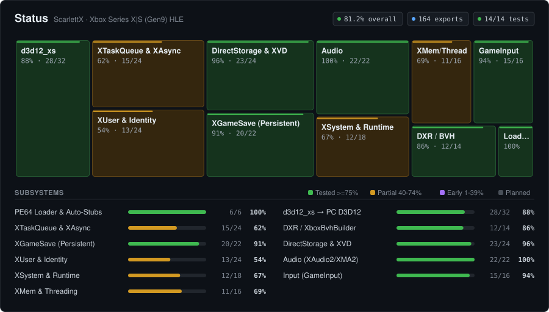
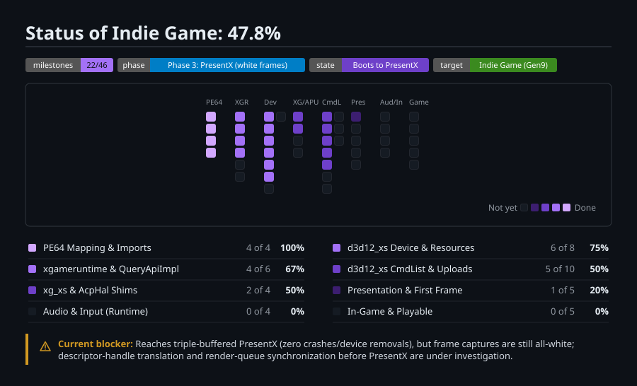

# ScarlettX

**ScarlettX** is an experimental, open-source high-level emulator (HLE) for **Xbox Series X|S (Scarlett / Gen9 Game Core)** x86-64 software, designed to execute legally obtained GDK titles end-to-end by emulating the Scarlett OS, Game Core runtime, unified memory model, `d3d12_xs`, and ray-tracing (`XboxBvhBuilder` / DXR) stack.

> **Legal notice:** ScarlettX does not include, decrypt, or distribute any proprietary Microsoft/Xbox binaries, keys, firmware, or commercial game assets. All automated tests run against synthetic x86-64 PE titles built from source in this repository.

<!-- SCARLETTX_STATUS_START -->
## Status





**Emulator Status:** `16.8%` (62 of 369 tracked milestones, including unimplemented `0%` subsystems) · **Indie Game (Gen9 Unity IL2CPP):** `47.8%` (22 of 46 bring-up milestones) · **Exports:** `240` · **Tests:** `17/17` passing · **Target:** `Xbox Series X|S (Gen9)`

| Subsystem | Category | Progress | Coverage | Details |
| :--- | :--- | :---: | :---: | :--- |
| **XGameSave (offline)** | `xgameruntime` | `8 of 16` | `50%` | 20 exports; local disk-backed containers & sync/async blob R/W (not yet verified in a real commercial title) |
| **PE64 Loader & Auto-Stubs** | `Core` | `5 of 11` | `45%` | PE32+ mapping, relocs, named/ordinal IAT, API-sets, auto-stubs; unwind tables, implicit TLS & PEB image base pending |
| **XSystem & QueryApiImpl** | `xgameruntime` | `7 of 20` | `35%` | 17 exports + 2 reverse-engineered QueryApiImpl COM tables; additional runtime GUIDs still E_NOINTERFACE |
| **XTaskQueue & XAsync** | `xgameruntime` | `7 of 20` | `35%` | 11 XTaskQueue + 4 XAsync exports; manual/threadpool queues working, ABI/teardown hardening pending |
| **XUser & Identity (offline)** | `xgameruntime` | `5 of 20` | `25%` | 13 exports; offline synthetic Xbox Live profile, XUID & gamertag stubs only |
| **d3d12_xs → PC D3D12 & PSOs** | `Graphics` | `11 of 50` | `22%` | Xbox COM proxies for device/queues/fences/heaps/PSOs/cmdlists/PresentX swapchain; boots an unencrypted indie title to PresentX, but frames are still white (descriptor translation, sync & tiled copies pending) |
| **DirectStorage & XVD** | `Storage` | `4 of 20` | `20%` | 22 dstorage_xs exports + unencrypted XVD parser/PackageVfs; synthetic LZ-RLE test codec only (no GDeflate/BCPack) |
| **XMem & Threading** | `xgameruntime` | `4 of 20` | `20%` | 11 exports; basic alloc hooks & VirtualAlloc/Free (no Xbox MEM_GRAPHICS or physical-virtual aliasing) |
| **Audio (XAudio2 / AcpHal)** | `Media` | `3 of 20` | `15%` | 23 exports; AcpHal APU/SHAPE allocators work on real title, XAudio2_9 ordinal #1 still fails closed (E_NOTIMPL) |
| **Input (GameInput)** | `Input` | `3 of 20` | `15%` | 15 exports (ordinal #1); virtual controller scaffold only, live host XInput/keyboard bridge pending |
| **DXR / XboxBvhBuilder** | `Graphics` | `2 of 20` | `10%` | 8 synthetic BVH exports + software BVH test fallback only; real XboxBvhBuilder ABI & GPU DXR unimplemented |
| **Networking (HTTP / XCurl)** | `Networking` | `2 of 20` | `10%` | 19 libHttpClient + 12 XCurl offline mock shims only (no live HTTP/TLS transport) |
| **Middleware (Bink2 / FSR)** | `Middleware` | `1 of 20` | `5%` | 12 Bink2 + 10 FidelityFX offline test stubs only (no real video decoding or GPU upscaling) |
| **Hardware DXR & Vulkan Backend** | `Graphics` | `0 of 16` | `0%` | Hardware GPU ray tracing (DXR Tier 1.1) and cross-platform Vulkan / vkd3d-proton backend |
| **Live Xbox Services (XSAPI/WinRT)** | `Platform` | `0 of 16` | `0%` | Full Xbl* Xbox Live services, WinRT runtime activation, achievements, multiplayer |
| **Production Codecs (XMA2/GDeflate/Bink)** | `Media` | `0 of 16` | `0%` | Native SHAPE XMA2 transform audio, hardware GDeflate/BCPack, production Bink2 & GPU FSR |
| **RDNA2 XS2 Shader Lifting** | `Graphics` | `0 of 16` | `0%` | Precompiled RDNA2/Scarlett GPU microcode lifting to PC DXIL or SPIR-V |
| **Retail XVC/XVD Crypto** | `Storage` | `0 of 12` | `0%` | Encrypted & digitally signed retail .xvc/.xvd package decryption and verification |
| **Xbox Unified Memory & KernelX** | `Platform` | `0 of 16` | `0%` | MEM_GRAPHICS, 64 KB / 4 MB physical-virtual aliasing, full Game OS kernel services |

> **Not started (0%):** Xbox unified memory (`MEM_GRAPHICS`) & full KernelX, precompiled RDNA2 `XS2` ISA lifting, encrypted retail XVC/XVD decryption, production GDeflate/XMA2/Bink decoding, hardware DXR & Vulkan backend, and live XSAPI/WinRT services. Passing synthetic tests do not imply commercial retail title execution.

_Regenerate with `python tools/generate_status.py` after adding new HLE APIs or subsystems._
<!-- SCARLETTX_STATUS_END -->

## Architecture Overview

Because Xbox Series X|S executables are native **x86-64 PE32+** binaries targeting Microsoft's Game Development Kit (GDK), ScarlettX focuses on **high-level OS, runtime, memory, and GPU/RT emulation** rather than CPU static recompilation:

| Subsystem | Components | Status |
| :--- | :--- | :--- |
| **Package & PE64 Loader** | `MicrosoftGame.Config` parser (`XboxGen9`/`Scarlett`), in-process PE64 mapper (`DIR64`/`HIGHLOW` relocations, page protections), named/ordinal IAT & API-set resolution (`api-ms-win-core-synch-l1-2-*`, `rtlsupport`, `psm-appnotify`), dynamic `LoadLibrary` shim redirection, x64 auto-stub thunk generator | Phase 1 updated + tests |
| **GDK Runtime (`xgameruntime.dll`)** | C ABI for `XGameRuntime*`, `XTaskQueue*`, `XAsync*`, `XUser*`, persistent disk-backed `XGameSave*`, `XSystem*`, `XMem*` hooks & virtual memory, `XThread*`, `XStorage`, `InitializeApiImpl`/`InitializeApiImplEx`, `UninitializeApiImpl`, `XErrorReport`, plus ScarlettX-owned guest COM vtables for `QueryApiImpl` GUIDs `{073B7DCB-1FCF-4030-94BE-E3C9EB623428}` and `{37E56907-2F10-41E8-B72F-36EDB185331A}` | Phase 3 updated + tests |
| **Graphics (`d3d12_xs` / `xg_xs`)** | `d3d12_xs.dll` (`D3D12XboxCreateDevice`, `D3D12XboxSetProcessDebugFlags`, `D3D12SerializeRootSignature`, `D3D12XboxCreateSyntheticDevice`, ScarlettX-owned Xbox COM proxy wrappers for device, queues `0x2`/`0x10`, fences, descriptor heaps, allocators, root signatures, graphics PSOs, resources, command lists, and frame events) + `xg_xs.dll` (`XGCreateTexture2DComputer`, `XGComputeOptimalSwizzleMode`) | Phase 3 in progress + tests |
| **Ray Tracing (DXR / BVH)** | Synthetic `d3d12_xs` DXR acceleration-structure prebuild/build/destroy + `XboxBvhBuilder.dll` (synthetic signatures + deterministic software BVH fallback; hardware DXR requires a DXR-capable GPU) | Synthetic scaffold + tests |
| **DirectStorage & XVD (`dstorage_xs.dll`)** | Renamed to Xbox `dstorage_xs.dll`; async worker-thread I/O queues, file/memory/XVD reads, fence callbacks, status arrays, cancellation by tag, synthetic LZ-RLE test codec, unencrypted XVD container parser + `PackageVfs::MountXvd` | Phase 1 cleanup + tests |
| **Audio (`xaudio2_9.dll` / `AcpHal.dll`)** | `XAudio2_9.dll` with verified ordinal `#1` (`XAudio2Create`, failing closed for real titles until Xbox COM wrapper exists) + `AcpHal.dll` (`ApuAlloc`/`ApuFree`/`ApuMapVirtualAddress`/`ApuIsVirtualAddressValid`/`AcpHalCreate`/`AcpHalAllocateShapeContexts`/`AcpHalReleaseShapeContexts`) + headless PCM mixer & synthetic XMA2 test decoder | Phase 3 updated + tests |
| **Input (`GameInput.dll`)** | `GameInput.dll` with verified ordinal `#1` (`GameInputCreate`), virtual Xbox Series controller & keyboard enumeration, reading history (`Current`/`Next`/`Previous`), deterministic input injection, 4-motor impulse-trigger rumble | Phase 1 updated + tests |
| **Shader & PSO Pipeline** | DXIL/DXBC container parser (stage, shader model, I/O params, RT exports, embedded root sig, content hash), Xbox-private chunk stripping (`XBOX`/`XS2M`), explicit unsupported-format error on precompiled RDNA2 `XS2`, D3D12 root signatures, descriptor heaps, graphics/compute/software-DXR PSOs, pipeline cache stats, draw/dispatch/RT command execution | Synthetic scaffold + tests |
| **Middleware (`Bink2` / `FidelityFX`)** | `Bink2Scarlett.dll` (open/decode/advance/pause/seek/RGBA/BGRA/summary), `amd_fidelityfx_loader_xbox.dll` & `amd_fidelityfx_upscaler_xbox.dll` (context lifecycle, quality ratios, render resolution, jitter, deterministic bilinear upscale & frame hash) | Synthetic scaffold + tests |
| **Networking (`libHttpClient` / `XCurl`)** | `libHttpClient.GDK.dll` (init, mock registry, request setup, async callbacks, offline fallback), `XCurl.dll` (easy handle lifecycle, `curl_easy_setopt`, write callbacks, `curl_easy_getinfo`, slist headers, mock/offline responses) | Synthetic scaffold + tests |
| **End-to-End Integration** | `scarlett_arena` synthetic Gen9 game booting via in-process PE64 mapper (with isolated guest `atexit` cleanup) and child process across `xgameruntime`, `dstorage_xs`/XVD, `GameInput`, `d3d12_xs` + software BVH RT, `XAudio2`, and `XGameSave` | Synthetic E2E + tests |

### Real-Title Bring-Up (Verified Observations — Unencrypted Indie Game)

Testing against an unencrypted commercial Xbox Series X|S (`Scarlett`) Unity IL2CPP indie game (kept strictly outside the repository) established:

- **Phase 1 — Static inspection & image mapping:** PE64 image maps with 405 imported symbols and 3 remaining auto-stubs; ScarlettX's `d3d12_xs.dll`, `xg_xs.dll`, and `AcpHal.dll` resolve all static Xbox imports.
- **Phase 2 — `QueryApiImpl` COM interface (`{073B7DCB-1FCF-4030-94BE-E3C9EB623428}`):** Reverse-engineered the target's Windows x64 register ABI (`RCX=api_id`, `RDX=riid`, `R8=out_impl`) and vtable offsets (`+0x00`/`+0x08`/`+0x10`, `+0x30`, `+0x60`, `+0x80`, `+0x88`, `+0xE8`). Implemented a ScarlettX-owned 32-slot guest COM object in `xgameruntime.dll` with dedicated ABI tests (`test_query_api_impl`).
- **Phase 3 — Second `QueryApiImpl` GUID, `AcpHal`, and `d3d12_xs` Proxy Bring-Up (In Progress):**
  - `QueryApiImpl({37E56907-2F10-41E8-B72F-36EDB185331A})` now returns `S_OK` via a ScarlettX-owned guest COM object (`+0x80`/`+0x30`/`+0x38`/`+0x88` observed; two additional runtime GUIDs `{973A344E-...}` and `{E349BD1A-...}` still return `E_NOINTERFACE`).
  - `AcpHal` shape-context allocation succeeds and `d3d12_xs` guest-facing COM proxies run past Unity's D3D12 initialization with zero crashes or device removals — executing 61,000+ `ExecuteCommandLists`, 102,000+ `CmdList::Close`, and 350+ triple-buffered 1920×1080 `PresentX` calls (`CommandQueue::vtable[30]`) into a Win32/DXGI swapchain.
  - **Active blocker:** Frame captures are still all-white (`0` non-white pixels). Descriptor-handle/heap-type translation (`OMSetRenderTargets` / `CopyDescriptorsSimple`), render-queue synchronization before `PresentX`, and Xbox tiled-texture copy semantics are under investigation.
- **Current classification:** **Boots to `PresentX` with white frames** (not yet visible rendered output or playable gameplay).

### Current Limitations

- **Xbox COM vtable wrappers:** `d3d12_xs` guest-facing proxies are in active Phase 3 bring-up (command-list slots, copy ABI, and `PresentX` presentation are incomplete); `XAudio2Create` still fails closed (`E_NOTIMPL`) for real titles until an Xbox `IXAudio2` COM wrapper is implemented.
- **Unimplemented 0% subsystems:** Xbox unified memory (`MEM_GRAPHICS`, 64 KB / 4 MB physical-virtual aliasing) & full KernelX, precompiled RDNA2 `XS2` ISA lifting, encrypted retail `.xvc`/`.xvd` decryption, production GDeflate/BCPack/XMA2/Bink2/GPU FSR codecs, hardware DXR Tier 1.1 & Vulkan backend, and live XSAPI/WinRT services.
- **Codecs, Middleware & Networking:** `Bink2Scarlett`, `amd_fidelityfx_*_xbox`, `dstorage_xs` decompression, `XMA2`, `libHttpClient.GDK`, and `XCurl` use deterministic offline/synthetic HLE shims for automated tests. Passing synthetic tests do not imply commercial retail title execution.

See [docs/ARCHITECTURE.md](docs/ARCHITECTURE.md) and [docs/ROADMAP.md](docs/ROADMAP.md) for detailed design notes.

## Building & Running Tests

Requirements on Windows (x86-64):
- CMake 3.20+
- Ninja
- C++20 compiler (MinGW-w64 GCC 13+ or MSVC 2022)
- Windows D3D12 runtime + WARP (included in Windows 10/11 & Server 2022)

```bash
cmake -S . -B build -G Ninja
cmake --build build
ctest --test-dir build --output-on-failure
```

## Running the Synthetic Scarlett Test Games

```bash
# Inspect a Game Core package manifest and PE imports
./build/scarlettx inspect build/packages/hello_scarlett

# Boot the synthetic hello_scarlett title headlessly
./build/scarlettx boot build/packages/hello_scarlett --headless --frames 3

# Boot the synthetic ray-tracing showcase and dump a rendered RT frame
./build/scarlettx boot build/packages/rt_showcase --headless --frames 2 --rt-dump rt_frame.ppm

# Run the full-stack end-to-end synthetic game demo (PE64 + XVD/DirectStorage + GameInput + D3D12/BVH RT + XAudio2/XMA2 + XGameSave)
./build/test_scarlett_arena_e2e
```
